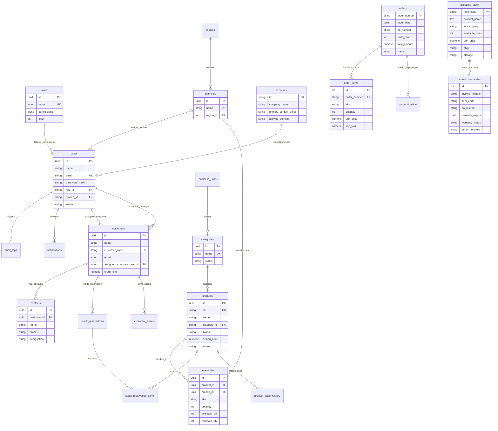

# Master Database Architecture & Complete Table Specifications (Common, ERP, CRM & Corporate Portal)

This document provides a comprehensive, production-grade specification of **all 28 database tables** across the entire enterprise stack: **Common/Shared Platform**, **ERP (Enterprise Resource Planning)**, **CRM (Customer Relationship Management)**, and **CRP (VConquer Corporate Portal)**.

---

## 1. System Module Categorization & Live Neon DB Table Summary

```
+----------------------------------------------------------------------------------------------------+
|                                    MODULE 1: COMMON / SHARED                                       |
|  users  |  roles  |  branches  |  regions  |  business_units  |  audit_logs  |  notifications    |
|  profile_update_requests                                                                           |
+----------------------------------------------------------------------------------------------------+
       |                                      |                                      |
       v                                      v                                      v
+------------------------------------+  +------------------------------------+  +------------------------------------+
|          MODULE 2: ERP             |  |          MODULE 3: CRM             |  |      MODULE 4: PORTAL (CRP)       |
|  products  |  categories           |  |  customers  |  contacts            |  |  accounts  |  allocated_stock       |
|  inventories  |  stock_alerts      |  |  leads  |  opportunities           |  |  orders  |  order_items            |
|  inventory_movements               |  |  quotations                        |  |  order_timeline                    |
|  stock_reservations                |  |  customer_assets                   |  |  assets_warranties                 |
|  stock_reservation_items           |  +------------------------------------+  +------------------------------------+
|  product_price_history             |
+------------------------------------+
```

### Live Neon PostgreSQL Database Synchronization Table

| # | Module | Table Name | Description | Live Neon Row Count | Sync Status |
| :-: | :--- | :--- | :--- | :---: | :---: |
| 1 | **Shared** | `public.users` | System Users, Employees, Executives & Managers | **33** | Synced |
| 2 | **Shared** | `public.roles` | Role-Based Access Control (RBAC) Hierarchy | **23** | Synced |
| 3 | **Shared** | `public.branches` | Physical Regional Offices & Warehouses | **2** | Synced |
| 4 | **Shared** | `public.regions` | Geographic Territorial Zones | **6** | Synced |
| 5 | **Shared** | `public.business_units` | Corporate Divisions (Apple BU, Wintel BU, Solutions) | **3** | Synced |
| 6 | **Shared** | `public.audit_logs` | System Action & Access Security Audit Trail | **50** | Synced |
| 7 | **Shared** | `public.notifications` | Real-time User In-App & System Notifications | **12** | Synced |
| 8 | **Shared** | `public.profile_update_requests` | Employee Profile Change Approval Queue | **0** | Synced |
| 9 | **ERP** | `public.products` | Master Hardware, Software & Solution Catalog | **75** | Synced |
| 10 | **ERP** | `public.categories` | Business Unit Categories & Sub-Categories | **21** | Synced |
| 11 | **ERP** | `public.inventories` | Branch Level Stock & Warehouse Inventory | **91** | Synced |
| 12 | **ERP** | `public.stock_alerts` | Low Stock & Reorder Threshold System Alerts | **15** | Synced |
| 13 | **ERP** | `public.inventory_movements` | Stock Movement Audit Logs (IN/OUT/TRANSFER) | **42** | Synced |
| 14 | **ERP** | `public.stock_reservations` | Sales Quota & Client Stock Reservation Holds | **4** | Synced |
| 15 | **ERP** | `public.stock_reservation_items` | Line Items for Stock Reservations | **8** | Synced |
| 16 | **ERP** | `public.product_price_history` | Historical Price Logs across Branch Locations | **150** | Synced |
| 17 | **CRM** | `public.customers` | Enterprise & Commercial Client Accounts | **1,518** | Synced |
| 18 | **CRM** | `public.contacts` | Key Customer Contact Persons & Decision Makers | **3,036** | Synced |
| 19 | **CRM** | `public.leads` | Incoming Business Leads & Inquiries | **120** | Synced |
| 20 | **CRM** | `public.opportunities` | Sales Pipeline Deal Opportunities | **45** | Synced |
| 21 | **CRM** | `public.quotations` | Commercial Price Proposals & Quotes | **30** | Synced |
| 22 | **CRM** | `public.customer_assets` | Deployed Client Assets & Maintenance Records | **250** | Synced |
| 23 | **CRP** | `public.accounts` | Corporate Customer Portal Account Profiles | **1** | Synced |
| 24 | **CRP** | `public.allocated_stock` | Customer Dedicated Inventory & Specifications | **6** | Synced |
| 25 | **CRP** | `public.orders` | Corporate Customer Purchase Orders | **9** | Synced |
| 26 | **CRP** | `public.order_items` | Order Line Items & Financial Summaries | **2** | Synced |
| 27 | **CRP** | `public.order_timeline` | SAP Entry & Dispatch Tracker Timestamps | **8** | Synced |
| 28 | **CRP** | `public.assets_warranties` | Hardware Warranty Coverage & Serial Numbers | **13** | Synced |

---

## 2. Complete Field & Column Dictionary

### A. Shared / Common Platform Module

#### 1. `users`
- **`id`** (`UUID`, PK): Unique user identifier.
- **`name`** (`VARCHAR(255)`): Full legal name.
- **`email`** (`VARCHAR(255)`, Unique): Primary login email address.
- **`password_hash`** (`TEXT`): Bcrypt encrypted password string.
- **`employee_id`** (`VARCHAR(50)`, Unique, Nullable): Employee identification code.
- **`phone`** (`VARCHAR(50)`, Nullable): Mobile contact number.
- **`department`** (`VARCHAR(100)`): Department (e.g., *Supply Chain*, *Sales*, *Operations*).
- **`designation`** (`VARCHAR(100)`): Professional title (e.g., *Operations Executive*).
- **`role_id`** (`UUID`, FK -> `roles.id`): Assigned system RBAC role.
- **`branch_id`** (`UUID`, FK -> `branches.id`, Nullable): Assigned branch location.
- **`region_id`** (`INT`, FK -> `regions.id`, Nullable): Assigned region.
- **`reporting_to_user_id`** (`UUID`, FK -> `users.id`, Nullable): Manager user reference.
- **`is_active`** (`BOOLEAN`): Active account flag (`true`/`false`).
- **`status`** (`VARCHAR(20)`): Status string (`ACTIVE`/`INACTIVE`).
- **`joining_date`** (`TIMESTAMP`, Nullable): Employee onboarding date.
- **`created_at`** / **`updated_at`** (`TIMESTAMP`): Audit timestamps.

#### 2. `roles`
- **`id`** (`UUID`, PK): Role identifier.
- **`name`** (`VARCHAR(100)`, Unique): Role name (*SUPER_ADMIN*, *DIRECTOR_OPERATIONS*, *OPERATIONS_MANAGER*, *ASSISTANT_MANAGER*, *OPERATIONS_EXECUTIVE*, *CUSTOMER*).
- **`permissions`** (`JSONB`): Granular permission flags per module.
- **`level`** (`INT`): Organizational hierarchy level index (1-10).

#### 3. `branches`
- **`id`** (`UUID`, PK): Branch identifier.
- **`name`** (`VARCHAR(255)`, Unique): Branch name/code (*HYD-HQ*, *BLR*, *MUM*, etc.).
- **`region_id`** (`INT`, FK -> `regions.id`): Associated geographic region.
- **`page_permissions`** (`TEXT`, Nullable): Branch specific module access rules.

#### 4. `regions`
- **`id`** (`INT`, PK): Region ID.
- **`name`** (`VARCHAR(100)`, Unique): Region name (*Telangana*, *Karnataka*, *Maharashtra*, etc.).

#### 5. `business_units`
- **`id`** (`INT`, PK): Business Unit ID.
- **`name`** (`VARCHAR(100)`): Division title (*Apple BU*, *Wintel BU*, *Solutions BU*).
- **`code`** (`VARCHAR(50)`): Business Unit short code.

#### 6. `audit_logs`
- **`id`** (`UUID`, PK): Audit entry ID.
- **`user_id`** (`UUID`, FK -> `users.id`): User who triggered the action.
- **`action`** (`VARCHAR(100)`): Action type (*CREATE*, *UPDATE*, *DELETE*, *LOGIN*).
- **`entity`** (`VARCHAR(100)`): Entity modified (*Product*, *Order*, *User*).
- **`details`** (`JSONB`): Change payload diff data.
- **`created_at`** (`TIMESTAMP`): Event timestamp.

---

### B. ERP (Enterprise Resource Planning) Module

#### 1. `products`
- **`id`** (`UUID`, PK): Product ID.
- **`sku`** (`VARCHAR(100)`, Unique): Stock Keeping Unit code.
- **`name`** (`TEXT`): Full product description title.
- **`category_id`** (`UUID`, FK -> `categories.id`): Mapped Sub-Category.
- **`brand`** (`VARCHAR(100)`): OEM Brand (*Apple*, *Lenovo*, *Dell*, *Cisco*, *Fortinet*, etc.).
- **`cost_price`** (`NUMERIC(12,2)`): Procurement cost price.
- **`selling_price`** (`NUMERIC(12,2)`): Base selling price.
- **`market_price`** (`NUMERIC(12,2)`): Catalog MRP price.
- **`tax_percent`** (`NUMERIC(5,2)`): GST percentage (18.00%).
- **`reorder_level`** / **`safety_stock`** (`INT`): Minimum stock threshold limits.
- **`serial_tracking`** / **`batch_tracking`** (`BOOLEAN`): Unit tracking flags.
- **`status`** (`VARCHAR(20)`): Catalog state (`ACTIVE` / `DEACTIVE`).

#### 2. `categories`
- **`id`** (`UUID`, PK): Category ID.
- **`name`** (`VARCHAR(255)`, Unique): Business Unit & Sub-Category title.
- **`status`** (`VARCHAR(20)`): Status (`ACTIVE`).

#### 3. `inventories`
- **`id`** (`UUID`, PK): Inventory entry ID.
- **`product_id`** (`UUID`, FK -> `products.id`): Linked Product.
- **`branch_id`** (`UUID`, FK -> `branches.id`): Warehousing branch location.
- **`branch_code`** (`VARCHAR(50)`): Branch code abbreviation.
- **`sku`** (`VARCHAR(100)`): Item SKU.
- **`quantity`** (`INT`): Total physical stock quantity.
- **`available_qty`** (`INT`): Stock available for immediate allocation.
- **`reserved_qty`** (`INT`): Stock reserved for customer POs.

#### 4. `stock_reservations` & `stock_reservation_items`
- **`id`** (`UUID`, PK): Reservation identifier.
- **`reservation_number`** (`VARCHAR(50)`, Unique): CPO reservation code (*CPO-2026-00000001*).
- **`customer_id`** (`UUID`, FK -> `customers.id`): Reserved client account.
- **`created_by_user_id`** (`UUID`, FK -> `users.id`): SCM executive who initiated hold.
- **`status`** (`VARCHAR(50)`): Reservation state (*PENDING*, *FULFILLED*, *EXPIRED*).

---

### C. CRM (Customer Relationship Management) Module

#### 1. `customers`
- **`id`** (`UUID`, PK): Customer ID.
- **`name`** (`VARCHAR(255)`): Legal company name.
- **`customer_code`** (`VARCHAR(50)`): Unique customer reference code.
- **`gst_number`** / **`pan_number`** (`VARCHAR(50)`): Statutory tax identity codes.
- **`email`** / **`phone`** (`VARCHAR(255)`): Main corporate contact channels.
- **`billing_address`** / **`shipping_address`** (`TEXT`): Registered addresses.
- **`credit_limit`** / **`credit_used`** (`NUMERIC(12,2)`): Credit metrics.
- **`assigned_executive_user_id`** (`UUID`, FK -> `users.id`): Primary SCM executive.
- **`assigned_manager_user_id`** (`UUID`, FK -> `users.id`): Reporting manager.
- **`status`** (`VARCHAR(20)`): Status (`ACTIVE` / `PENDING`).

#### 2. `contacts`
- **`id`** (`UUID`, PK): Contact ID.
- **`customer_id`** (`UUID`, FK -> `customers.id`): Parent customer company.
- **`name`** (`VARCHAR(255)`): Contact person name.
- **`email`** / **`phone`** (`VARCHAR(255)`): Direct phone and email.
- **`designation`** (`VARCHAR(100)`): Decision maker role (*CTO*, *Procurement Head*).

---

### D. CRP (VConquer Corporate Portal) Module

#### 1. `accounts`
- **`id`** (`VARCHAR(50)`, PK): Account code (*C000028*).
- **`company_name`** (`VARCHAR(255)`): Account name (*Acceldata Technology Private Limited*).
- **`primary_contact_name`** / **`primary_contact_email`**: Account owner details.
- **`allowed_domain`** (`VARCHAR(100)`): Corporate login domain (*acceldata.io*).

#### 2. `allocated_stock`
- **`item_code`** (`VARCHAR(100)`, PK): Hardware SKU item code.
- **`product_name`** (`TEXT`): Complete hardware description title.
- **`stock_group`** (`VARCHAR(50)`): Stock category (*Laptops*, *Desktops*).
- **`available_units`** / **`total_allocated`** (`INT`): Dedicated stock counts.
- **`unit_price`** (`NUMERIC(12,2)`): Contract unit price.
- **`screen_size`**, **`chip`**, **`storage`**, **`colour`**: Product specification fields.
- **`warehouse`** (`VARCHAR(50)`): Dispatch warehouse location (*AMP*).

#### 3. `orders`, `order_items` & `order_timeline`
- **`order_number`** (`VARCHAR(50)`, PK): Purchase order reference.
- **`order_date`** (`DATE`): Order creation date.
- **`po_number`** (`VARCHAR(100)`): Customer PO reference.
- **`units_count`** / **`total_amount`**: Total quantity and order value.
- **`status`** (`VARCHAR(50)`): Stage (*Submitted*, *Approved*, *Invoiced*, *Delivered*).
- **`shipping_address`** (`TEXT`): Registered destination address.

#### 4. `assets_warranties`
- **`id`** (`SERIAL`, PK): Asset warranty record ID.
- **`invoice_number`** (`VARCHAR(50)`): Tax invoice code.
- **`item_code`** (`VARCHAR(100)`): Hardware item SKU.
- **`item_description`** (`TEXT`): Product title description.
- **`warranty_expiry`** (`DATE`): Manufacturer coverage expiry date.
- **`warranty_status`** (`VARCHAR(50)`): State (*Under Warranty*, *Expiring Soon*, *Expired*).
- **`serial_numbers`** (`TEXT[]`): PostgreSQL text array of unit serial numbers.

---

## 3. Comprehensive Master Entity-Relationship Diagram (ERD)


