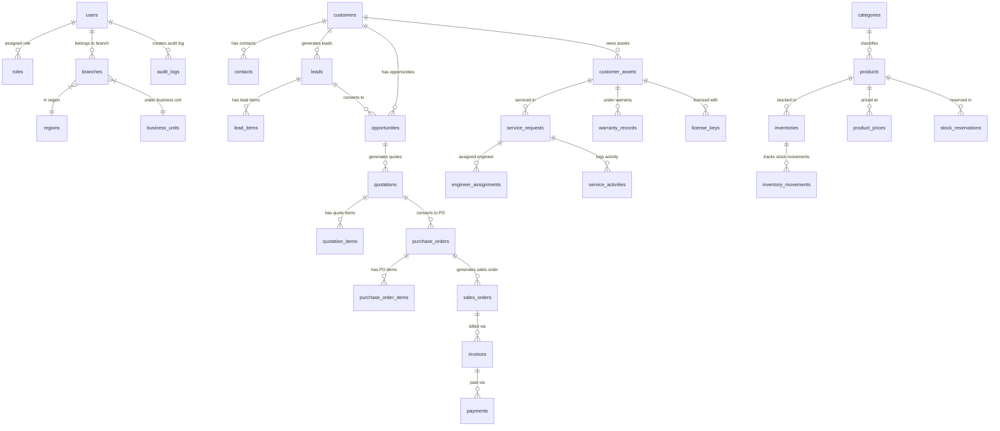

# Conquer Enterprise Platform - Database Architecture & ER Diagram Documentation

## 1. Executive Overview
`conquer_local_db` is the unified PostgreSQL enterprise database that powers both the CRM and ERP web applications. It enforces data deduplication, live transactional status synchronization, multi-branch ownership, role-based employee access control, and complete audit tracking across the enterprise supply chain and customer lifecycle.

---

## 2. Entity Relationship (ER) Diagram

---

## 3. Database Schema Overview & Module Breakdown

### Core ERP Schema (`public.*`)
- `users`: Core system users & employees.
- `branches`: Corporate branches & warehouses.
- `categories` & `products`: Product catalog master data.
- `inventories` & `inventory_movements`: Stock availability, warehouse zones, movement logs.
- `purchase_orders` & `purchase_order_items`: Procurement workflow.
- `customers`: Customer master profile data.
- `stock_reservations` & `stock_reservation_items`: Inventory stock lock mechanism.

### CRM Enterprise Schema (`crm.*`)
- `crm.opportunities`: **13,589 records** — Sales deals pipeline.
- `crm.quotations`: **13,582 records** — Quotation proposals and versions.
- `crm.sales_orders`: **13,578 records** — Confirmed customer orders.
- `crm.invoices`: **13,576 records** — Invoices issued.
- `crm.payments`: **13,572 records** — Customer payment collections.
- `crm.transactions`: **23,286 records** — Transactional ledger records.
- `crm.customer_assets`: **69,873 records** — Deployed hardware & client asset registry.
- `crm.customers`: **1,509 records** — Master CRM client directory.
- `crm.users`: **20 records** — CRM employees & executives.

---

## 4. Unified SQL Export
All schemas, tables, indices, foreign key constraints, and data records have been consolidated into:
📁 [`GLOBALDB_CONQUER.SQL`](file:///c:/Users/badin/OneDrive%20-%20gitam.in/Desktop/erp%20website/GLOBALDB_CONQUER.SQL)
