# Conquer_DB Technical ER Diagram & Architectural Documentation

## Executive Overview
`Conquer_DB` is the unified PostgreSQL enterprise database that powers both the CRM and ERP web applications. It enforces data deduplication, live transactional status synchronization, multi-branch ownership, role-based employee access control, and complete audit tracking across the enterprise supply chain lifecycle.

---

## Entity Relationship (ER) Diagram

```mermaid
erDiagram
    employees ||--o{ crm_users : "authenticates"
    employees ||--o{ erp_users : "authenticates"
    employees ||--o{ employees : "manages (hierarchy)"
    departments ||--o{ employees : "belongs to"
    branches ||--o{ employees : "located at"
    branches ||--o{ erp_users : "assigned to"
    branches ||--o{ customers : "serviced by"
    branches ||--o{ inventory : "holds stock"
    branches ||--o{ purchase_orders : "receives"
    branches ||--o{ reservations : "reserves from"
    branches ||--o{ opportunities : "tracked at"
    branches ||--o{ dispatches : "dispatched from"

    categories ||--o{ products : "classifies"
    products ||--o{ inventory : "stocked in"
    products ||--o{ quotation_items : "quoted in"
    products ||--o{ purchase_order_items : "ordered in"
    products ||--o{ reservations : "reserved in"

    inventory ||--o{ inventory_allocation : "allocates serial/batch"
    business_units ||--o{ inventory : "owned by"
    business_units ||--o{ purchase_orders : "assigned to"
    business_units ||--o{ reservations : "assigned to"
    business_units ||--o{ opportunities : "assigned to"

    customers ||--o{ leads : "generates"
    customers ||--o{ quotations : "receives"
    customers ||--o{ purchase_orders : "places"
    customers ||--o{ reservations : "holds reservation"
    customers ||--o{ opportunities : "has opportunity"
    customers ||--o{ invoices : "billed in"
    customers ||--o{ payments : "pays"

    leads ||--o{ quotations : "converts to"
    leads ||--o{ purchase_orders : "initiates"
    leads ||--o{ opportunities : "tracks"

    quotations ||--o{ quotation_items : "contains"
    quotations ||--o{ purchase_orders : "generates"
    quotations ||--o{ opportunities : "linked to"

    purchase_orders ||--o{ purchase_order_items : "contains"
    purchase_orders ||--o{ purchase_order_attachments : "attaches"
    purchase_orders ||--o{ purchase_order_status_history : "logs status"
    purchase_orders ||--o{ po_workflow : "executes engine"
    purchase_orders ||--o{ po_assignments : "assigns executive"
    purchase_orders ||--o{ reservations : "reserves stock"
    purchase_orders ||--o{ opportunities : "links opportunity"
    purchase_orders ||--o{ dispatches : "dispatches goods"
    purchase_orders ||--o{ invoices : "bills order"
    purchase_orders ||--o{ approval_history : "tracks approval"

    po_workflow ||--o{ workflow_history : "audits stage transitions"
    reservations ||--o{ reservation_history : "audits stock status"
    reservations ||--o{ opportunities : "updates stock status"
    reservations ||--o{ dispatches : "fulfills via dispatch"

    invoices ||--o{ payments : "receives payments"

    employees ||--o{ leads : "assigned sales executive"
    employees ||--o{ quotations : "created by"
    employees ||--o{ purchase_orders : "assigned sales / ops / manager"
    employees ||--o{ po_workflow : "assigned workflow task"
    employees ||--o{ reservations : "ops executive owner"
    employees ||--o{ opportunities : "sales / ops owner"
    employees ||--o{ dispatches : "dispatched by"
```

---

## Detailed Data Dictionary & Model Descriptions

### 1. Common Master Entities
- **`employees`**: Central Employee Master storing profile details, department, designation, branch, manager hierarchy pointer (`manager_id`), and authorization booleans (`crm_access`, `erp_access`, `admin_access`).
- **`crm_users`**: Separate authentication credentials table for CRM logins, linked to `employees.id`.
- **`erp_users`**: Separate authentication credentials table for ERP logins, linked to `employees.id`.
- **`customers`**: Shared Customer Master containing legal name, trade name, customer code, GSTIN, billing/shipping address structures, credit terms, and assigned sales executive.
- **`branches`**: Shared Branch Master containing branch code, address, and page-level permission configurations.
- **`categories` & `products`**: Shared Product Catalog storing SKUs, category classifications, brand, pricing metrics (cost price, selling price, market price, tax rate), warranty, serial tracking flags, and reorder parameters.
- **`inventory` & `inventory_allocation`**: Stock tracking per product per branch/warehouse zone. `inventory_allocation` tracks exact serial numbers and batch numbers allocated to reservations and purchase orders.
- **`business_units` & `oems`**: Organizational business units and original equipment manufacturers.

---

### 2. Workflow & Operational Entities
- **`leads`**: CRM Lead records capturing BANT qualification, value estimates, lead source, customer requirements, and assigned sales executive.
- **`quotations` & `quotation_items`**: Quotes generated for qualified leads, including line items, discounts, taxes, and validity terms.
- **`purchase_orders`**: Preserved PO master table extended with multi-branch fields (`branch_id`, `business_unit_id`, `warehouse_id`) and explicit employee ownership assignees (`assigned_sales_employee_id`, `assigned_operations_employee_id`, `assigned_manager_id`).
- **`po_workflow`**: Workflow Engine table tracking order execution through configurable stages (`PENDING_VERIFICATION`, `WAITING_FOR_RESERVATION`, `RESERVED`, `PROCESSING`, `READY_FOR_DISPATCH`, `DISPATCHED`, `DELIVERED`, `CLOSED`), assignees, and escalation levels.
- **`reservations` (`stock_reservations`)**: Physical stock reservation entries linked to customer POs, products, branches, and assigned operations executives.
- **`opportunities`**: Expanded Opportunity model capturing `lead_id`, `quotation_id`, `purchase_order_id`, `reservation_id`, `assigned_sales_id`, `assigned_operations_id`, `expected_dispatch_date`, `reserved_stock`, `expected_revenue`, `actual_revenue`, `probability`, `lost_reason`, and `current_stage`.
- **`dispatches`**: Stock dispatch fulfillment tracking carrier, tracking number, ship date, expected delivery date, and assigned logistics owner.
- **`invoices` & `payments`**: Billing invoices and transaction payment receipts.

---

### 3. Notification, Audit & Approval Entities
- **`notification_queue`**: Asynchronous notification pipeline holding events (`PO_CREATED`, `PO_APPROVED`, `RESERVATION_COMPLETED`, `DISPATCH_READY`, `DISPATCH_COMPLETED`, `INVOICE_GENERATED`) to be dispatched to Sales, Operations, Managers, and Customer Portal.
- **`approval_history`**: Audit trail of manager approvals, limit overrides, and rejections.
- **`workflow_history`**: Audit log of every workflow stage transition.
- **`audit_logs`**: System-wide access and mutation audit logs.

---

## Access Rule Hierarchy & Permissions Matrix

### Employee Access Permissions:
| Role / Department Hierarchy | CRM Access (`crm_access`) | ERP Access (`erp_access`) | Admin Access (`admin_access`) |
|---|---|---|---|
| **Super Admin** | `TRUE` | `TRUE` | `TRUE` |
| **Director Operations** | `TRUE` | `TRUE` | `FALSE` |
| **Operations / SCM Manager** | `TRUE` | `TRUE` | `FALSE` |
| **Assistant Operations Manager** | `TRUE` | `TRUE` | `FALSE` |
| **Operations Executive** | `TRUE` | `TRUE` | `FALSE` |
| **Sales Head / Manager** | `TRUE` | `FALSE` | `FALSE` |
| **Sales Executive** | `TRUE` | `FALSE` | `FALSE` |
| **Presales / Marketing / Post-Sales** | `TRUE` | `FALSE` | `FALSE` |

### Tiered Approval Matrix Thresholds:
- **Level 1 (Operations Executive)**: PO verification & reservation up to ₹500,000.
- **Level 2 (Assistant Manager)**: PO approval & allocation up to ₹2,500,000.
- **Level 3 (Operations Manager)**: PO approval & dispatch release up to ₹10,000,000.
- **Level 4 (Director Operations)**: Mandatory approval for POs exceeding ₹10,000,000 or custom margin overrides.

---

## Customer Portal Scoping
Customers logging into the system are strictly isolated to viewing records where `customer_id` matches their authenticated account:
- Their own Purchase Orders (`purchase_orders`)
- Their own Stock Reservations (`reservations`)
- Their own Dispatches (`dispatches`)
- Their own Invoices (`invoices`)
- Their own Payments (`payments`)
